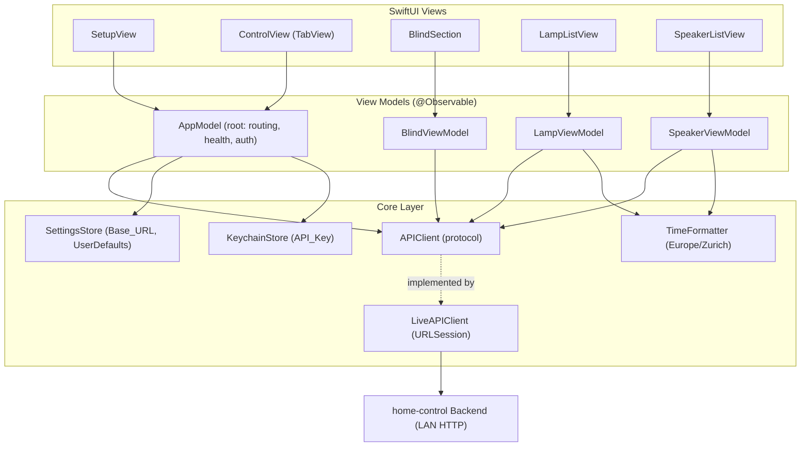
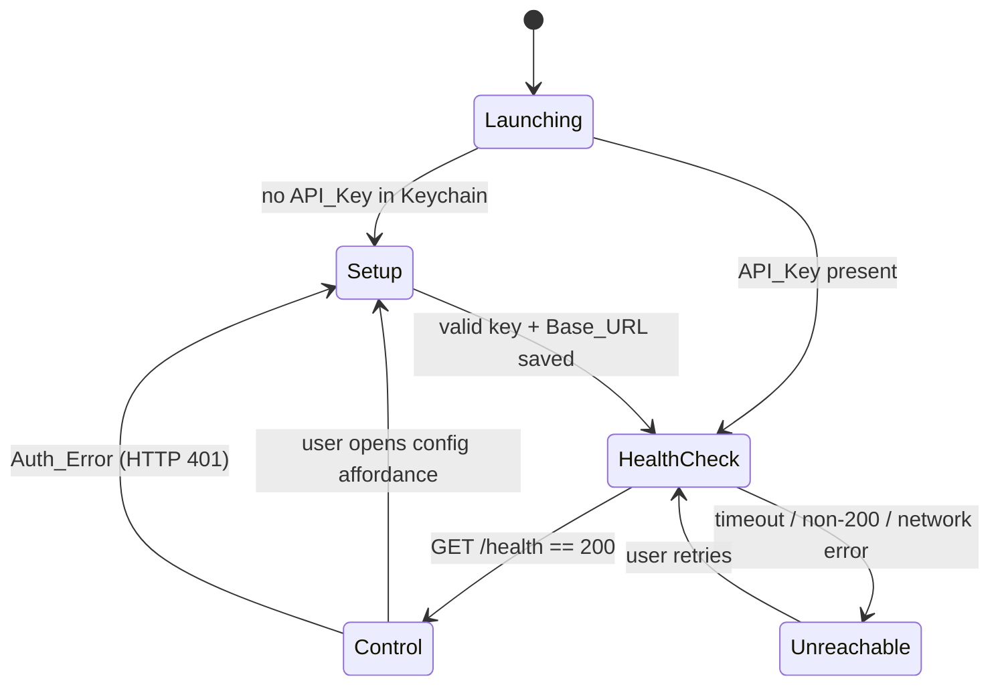
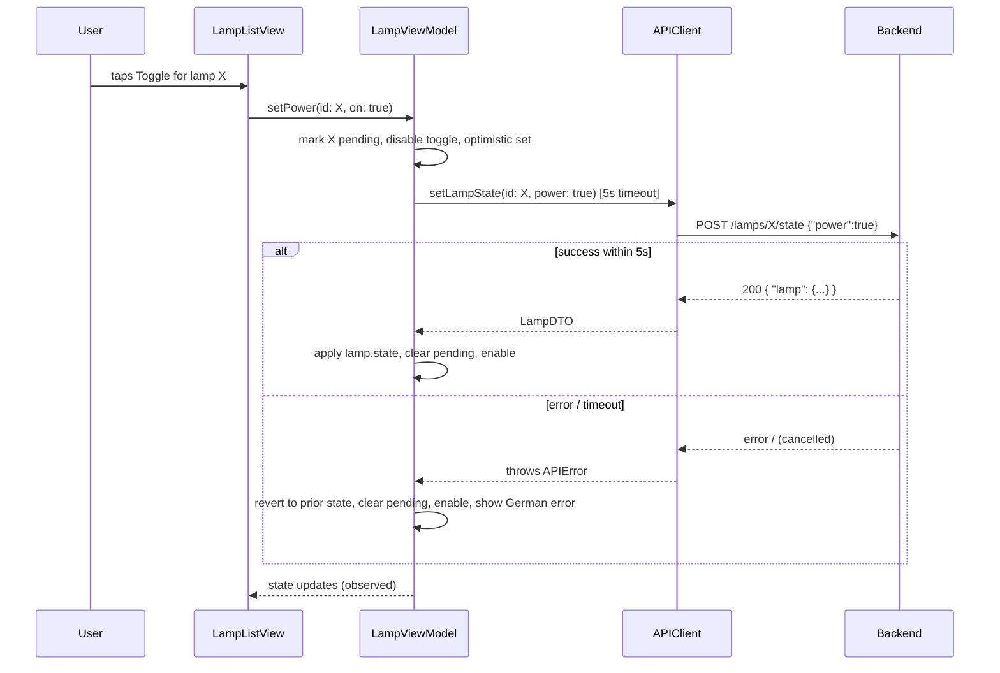
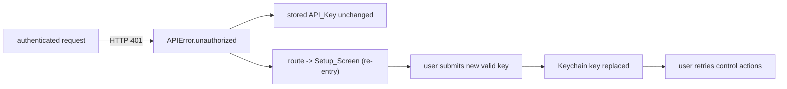

# Design Document

## Overview

This document describes the design of **WatchHomeControl**, a standalone native
Apple Watch application (targeting Apple Watch Ultra 2 on current watchOS) that
replicates the interactive parts of the `home-control` web app's "Home" tab:
blinds (Storen), lamps (Lampen), and Sonos speakers. The Aare river data panel
is explicitly out of scope.

The app is built exclusively with Apple-native tooling:

- **SwiftUI** for the user interface (`NavigationStack`, `List`, `Toggle`, `TabView`).
- **Swift Concurrency** (`async`/`await`, `Task`, structured cancellation) for all networking.
- **URLSession** for HTTP.
- **Observation framework** (`@Observable` macro) for view-model state.
- **Keychain Services** (Security framework) for secure API key storage.
- **UserDefaults** for the non-secret Base_URL.
- **Foundation** (`DateFormatter`/`TimeZone`) for Europe/Zurich time formatting.

There are no third-party dependencies, no iPhone companion app, and no build
step beyond Xcode. The app runs standalone and makes direct HTTP calls over the
LAN to the Go backend. Authentication is a static `X-API-Key` header. The UI is
in German, and displayed times use the Europe/Zurich timezone.

### Design Goals

- **Small and idiomatic**: a personal-use app; prefer modern SwiftUI patterns over
  heavy abstractions.
- **Testable core**: networking, DTO decoding, and command-to-endpoint mapping are
  pure/mockable so they can be unit- and property-tested without a device.
- **Resilient UI**: transient failures never blank the screen; pending controls are
  never clobbered by background polling.
- **Secure credential handling**: the API key lives only in the Keychain.

### Research Notes

Key platform facts that inform the design (Apple developer documentation):

- **Cleartext HTTP on watchOS** requires an App Transport Security exception. Because
  the Backend is on the LAN, `NSAppTransportSecurity` → `NSAllowsLocalNetworking`
  permits plaintext connections to local hosts without disabling ATS globally. IP
  literals such as `192.168.1.122` are treated as local by ATS local-networking rules.
  (Apple: *Preventing Insecure Network Connections* / ATS keys.)
- **`@Observable` (Observation framework)** replaces `ObservableObject`/`@Published`
  for view models and is the current recommended approach; views observe it via
  `@State` (owned) or `@Bindable` (for bindings). It avoids manual `objectWillChange`
  plumbing.
- **`URLSession` timeouts**: per-request deadlines are best enforced with
  `URLRequest.timeoutIntervalForRequest` combined with structured cancellation, or a
  `Task` timeout wrapper. Different endpoints in this app need different deadlines
  (5s vs 10s), so the timeout is a per-call parameter rather than a session default.
- **Watch lifecycle**: `@Environment(\.scenePhase)` reports `.active` / `.inactive` /
  `.background`. A polling loop should run only while `.active` to respect battery and
  the short foreground windows typical on watchOS. A cancellable `Task` tied to
  `.task { }`/`scenePhase` is the idiomatic mechanism.

Content was rephrased for compliance with licensing restrictions; see
[Apple Developer Documentation](https://developer.apple.com/documentation/) for the
authoritative reference.

## Architecture

The app follows a layered MV (Model–View) architecture with `@Observable` view
models mediating between SwiftUI views and a networking/persistence layer.



### Layers

- **Views** are declarative and stateless beyond `@State`/`@Bindable` bindings to view
  models. They render state and forward user intents.
- **View models** (`@Observable`) hold displayable state (lamp list, speaker list,
  pending flags, error banners) and orchestrate calls into the core layer. All
  mutation of view state happens on the main actor.
- **Core layer** provides the `APIClient` protocol (mockable), a concrete
  `LiveAPIClient` over `URLSession`, the `KeychainStore` and `SettingsStore`
  persistence wrappers, and the `TimeFormatter` utility.

### Routing / App State Machine

The root `AppModel` owns the top-level navigation state:



`AppModel.route` is an enum (`.setup`, `.control`, plus transient banners for
health/auth). The health check runs on launch when a Base_URL is configured and
gates entry into the control screen; a failed health check shows a German
"nicht erreichbar" message with a retry affordance but does not prevent later
manual retries.

### Data Flow: a lamp toggle (representative command)



## Components and Interfaces

### Networking: `APIClient`

The `APIClient` protocol defines every Backend operation the app performs. It is
the seam for testing: views/view models depend on the protocol; `LiveAPIClient`
implements it with `URLSession`, and tests inject a mock.

```swift
protocol APIClient: Sendable {
    /// GET /health — no X-API-Key. Returns true iff HTTP 200 within `timeout`.
    func checkHealth(timeout: Duration) async throws -> Bool

    /// POST /pairing/redeem {"code": ...} — no X-API-Key. Returns the API key on 200.
    func redeemPairingCode(_ code: String, timeout: Duration) async throws -> String

    /// POST /blind {"action": ...}
    func moveBlind(_ action: BlindAction, timeout: Duration) async throws

    /// GET /lamps — decodes both response shapes into [LampDTO].
    func fetchLamps(timeout: Duration) async throws -> [LampDTO]

    /// POST /lamps/{id}/state {"power": ...} -> { "lamp": {...} }
    func setLampState(id: String, power: Bool, timeout: Duration) async throws -> LampDTO

    /// GET /sonos/speakers -> [SpeakerDTO]
    func fetchSpeakers(timeout: Duration) async throws -> [SpeakerDTO]

    /// POST /sonos/speakers/{id}/play -> updated speaker
    func playSpeaker(id: String, timeout: Duration) async throws -> SpeakerDTO

    /// POST /sonos/speakers/{id}/pause -> updated speaker
    func pauseSpeaker(id: String, timeout: Duration) async throws -> SpeakerDTO

    /// POST /sonos/speakers/{id}/radio {uri,metadata,name} -> updated speaker
    func playRadio(id: String, request: RadioRequest, timeout: Duration) async throws -> SpeakerDTO
}
```

`Duration` is used at call sites so callers pass the requirement-mandated deadline
(`.seconds(5)` for `/health` and lamp state commands; `.seconds(10)` for blind,
speaker, list, and poll requests).

#### `LiveAPIClient`

`LiveAPIClient` builds requests from an injected `RequestBuilder` (see below) and a
credential provider closure that returns the current API key from the Keychain. It:

- Sets `X-API-Key` on all requests except `checkHealth`.
- Sets `Content-Type: application/json` on every request carrying a JSON body.
- Enforces the timeout via `URLRequest.timeoutIntervalForRequest` and a
  `Task`-cancellation guard, mapping cancellation/`URLError.timedOut` to
  `APIError.timeout`.
- Maps HTTP 401 to `APIError.unauthorized`, other non-2xx to `APIError.http(status:)`,
  transport failures to `APIError.network(underlying:)`, and decode failures to
  `APIError.decoding`.

#### `RequestBuilder`

A small pure helper that turns an endpoint + Base_URL into a `URLRequest`. Kept
separate from I/O so request construction (path, method, headers, body) is unit- and
property-testable without a network.

```swift
struct RequestBuilder {
    let baseURL: URL
    func build(_ endpoint: Endpoint, apiKey: String?) throws -> URLRequest
}

enum Endpoint {
    case health
    case redeem(code: String)
    case blind(BlindAction)
    case lamps
    case lampState(id: String, power: Bool)
    case speakers
    case speakerPlay(id: String)
    case speakerPause(id: String)
    case speakerRadio(id: String, RadioRequest)
}
```

### Persistence

```swift
protocol KeychainStore: Sendable {
    func readAPIKey() -> String?
    func saveAPIKey(_ key: String) throws
    func deleteAPIKey() throws
}

protocol SettingsStore: Sendable {
    var baseURL: URL { get }          // defaults to http://192.168.1.122:8080
    func setBaseURL(_ url: URL)
}
```

- `LiveKeychainStore` wraps `SecItemAdd`/`SecItemCopyMatching`/`SecItemUpdate`/
  `SecItemDelete` for a single generic-password item (service =
  `"ch.reber.watchhomecontrol"`, account = `"api_key"`).
- `LiveSettingsStore` persists the Base_URL string in `UserDefaults`, returning the
  default when absent or unparseable.

### URL Validation

A pure function used by the setup flow and Base_URL persistence:

```swift
enum URLValidator {
    /// Accepts only syntactically valid absolute http(s) URLs with a host.
    static func validate(_ raw: String) -> Result<URL, SetupError>
}
```

### View Models (`@Observable`)

```swift
@MainActor @Observable
final class AppModel {
    enum Route { case setup, control }
    var route: Route
    var healthState: HealthState        // .checking / .reachable / .unreachable(String)
    var authErrorMessage: String?

    let api: APIClient
    let keychain: KeychainStore
    let settings: SettingsStore

    func onLaunch() async            // Req 1.1/1.9, Req 3
    func submitSetup(baseURL: String, code: String) async -> SetupResult   // Req 1.4–1.8, 12
    func openConfig()                // Req 1.10
    func handleAuthError()           // Req 2.3/2.4
    func runHealthCheck() async      // Req 3
}
```

`submitSetup(baseURL:code:)` validates the Base_URL (Req 1.8) and that `code` is
exactly 6 digits (Req 1.5); on valid input, persists the Base_URL, then calls
`api.redeemPairingCode(code, timeout: .seconds(10))`; on success stores the
returned key in the Keychain and routes to the health check (Req 12.2); maps
400/401/429/timeout to the matching `SetupError` (Req 12.3–12.6) without mutating
the stored key.

```swift
@MainActor @Observable
final class BlindViewModel {
    var isPending: Bool
    var feedback: Feedback?          // German success/error banner
    func move(_ action: BlindAction) async   // Req 4
}

@MainActor @Observable
final class LampViewModel {
    private(set) var lamps: [LampRow]     // LampRow = DTO + pending flag + displayed power
    var refreshFailed: Bool               // non-blocking indicator (Req 5.7)
    func activate() async                 // initial load (Req 5.1)
    func toggle(id: String, on: Bool) async   // Req 6
    func applyPoll(_ fresh: [LampDTO])    // merge respecting pending (Req 9.2)
}

@MainActor @Observable
final class SpeakerViewModel {
    private(set) var speakers: [SpeakerRow]
    var refreshFailed: Bool
    func activate() async                 // Req 7.1
    func toggle(id: String, on: Bool) async   // Req 8
    func applyPoll(_ fresh: [SpeakerDTO]) // merge respecting pending (Req 9.3)
}
```

The `AppModel` also owns the **poll driver**: a cancellable `Task` started when the
control view becomes `.active` and cancelled when `.inactive`/`.background`. Each
Poll_Cycle (every 5s) calls `fetchLamps`/`fetchSpeakers` with a 10s timeout and hands
results to `applyPoll`, which preserves any pending rows (Req 9).

### Views

| View | Responsibility | Requirements |
|------|----------------|--------------|
| `RootView` | Switches on `AppModel.route`; runs `onLaunch`; hosts scenePhase-driven poll control | 1.1, 1.9, 3, 9.1, 9.6 |
| `SetupView` | Base_URL + Pairing_Code inputs, validation, redeem-on-submit; reused for config + re-pair after Auth_Error | 1.2–1.8, 1.10, 2.4, 2.5, 12 |
| `ControlView` | `TabView` (or scrolling `List`) hosting the three sections; config affordance | 1.10, 10.1 |
| `BlindSection` | "Hoch"/"Runter" buttons; disabled while pending | 4 |
| `LampListView` | Lamp rows with `Toggle`; empty-state message; refresh-failed hint | 5, 6 |
| `SpeakerListView` | Speaker rows with `Toggle`; offline disable; empty-state message | 7, 8 |
| `MessageBanner` | Reusable non-blocking German feedback/error presentation | 2.3, 4.5/4.6, 5.7, 6.5, 8.6, 9.5 |

### Utilities

```swift
enum ZurichTime {
    /// Formats an instant as HH:MM in Europe/Zurich (24h, zero-padded);
    /// returns the placeholder "--:--" when `date` is nil.
    static func hhmm(_ date: Date?) -> String
}
```

The formatter is configured with `TimeZone(identifier: "Europe/Zurich")` and a fixed
`HH:mm` format, so it applies CET/CEST automatically per date (Req 10.2–10.4).

## Data Models

DTOs are `Codable` structs mirroring the Backend contract. Decoding is lenient where
the requirements demand (two lamp response shapes, optional `friendly_name`).

```swift
enum BlindAction: String, Codable { case up, down }

struct LampState: Codable, Equatable {
    let power: Bool
    // Additional fields tolerated/ignored via default decoding.
}

struct LampDTO: Codable, Equatable, Identifiable {
    let id: String
    let friendlyName: String?      // maps "friendly_name"; optional (Req 5.5)
    let type: String?              // "ceiling"|"floor"|"strip"|"desk"
    let state: LampState

    /// Display label: friendly_name if present and non-empty, else id (Req 5.4/5.5).
    var displayName: String { (friendlyName?.isEmpty == false) ? friendlyName! : id }
}

/// Wrapper that decodes BOTH { "lamps": [...] } and a top-level [...] (Req 5.2/5.3).
enum LampsResponse: Decodable {
    case wrapped(lamps: [LampDTO])
    case bare([LampDTO])
    var lamps: [LampDTO] { switch self { case .wrapped(let l), .bare(let l): return l } }
}

struct LampCommandResponse: Codable { let lamp: LampDTO }   // POST /lamps/{id}/state (Req 6.4)

struct PairingCodeResponse: Codable { let apiKey: String }   // maps "api_key"; POST /pairing/redeem 200 (Req 12.2)

enum SpeakerState: String, Codable { case playing, paused, stopped }

struct SpeakerDTO: Codable, Equatable, Identifiable {
    let id: String                 // RINCON_...
    let name: String
    let state: SpeakerState
    let online: Bool
    let modelName: String?         // "model_name"

    /// Toggle position: on iff playing (Req 7.5/7.6).
    var isOn: Bool { state == .playing }
}

struct RadioRequest: Codable, Equatable {
    let uri: String
    let metadata: String
    let name: String
    static let radioBern1 = RadioRequest(
        uri: "x-rincon-mp3radio://stream.streambase.ch/radiobern1/mp3-192/direct/",
        metadata: "",
        name: "Radio Bern 1")
}
```

Row wrappers add UI-only state without polluting DTOs:

```swift
struct LampRow: Identifiable, Equatable {
    let dto: LampDTO
    var displayedPower: Bool       // optimistic value shown in the toggle
    var isPending: Bool
    var id: String { dto.id }
}

struct SpeakerRow: Identifiable, Equatable {
    let dto: SpeakerDTO
    var displayedState: SpeakerState
    var isPending: Bool
    var id: String { dto.id }
}
```

### Speaker toggle-to-endpoint mapping (pure)

A total function centralizes Req 8.1–8.3 so it can be tested exhaustively:

```swift
enum SpeakerCommand: Equatable { case play, pause, radio(RadioRequest) }

enum SpeakerToggleMapper {
    /// on == desired toggle position; current == speaker's current state.
    static func command(toggleOn on: Bool, current state: SpeakerState) -> SpeakerCommand {
        if on {
            return state == .stopped ? .radio(.radioBern1) : .play   // Req 8.1 / 8.2
        } else {
            return .pause                                            // Req 8.3
        }
    }
}
```

### Error and feedback types

```swift
enum APIError: Error, Equatable {
    case timeout
    case unauthorized            // HTTP 401 -> Auth_Error
    case http(status: Int)
    case network(String)
    case decoding
}

enum SetupError: Equatable {
    case malformedCode      // not exactly 6 digits (Req 1.5, 12.3)
    case invalidURL         // Req 1.8
    case codeInvalid        // redeem 401 (Req 12.4)
    case tooManyAttempts    // redeem 429 (Req 12.5)
    case redeemTimeout      // redeem 10s timeout (Req 12.6)
    case redeemFailed       // other redeem failure
}

struct Feedback: Equatable { enum Kind { case success, error }; let kind: Kind; let message: String }
enum HealthState: Equatable { case checking; case reachable; case unreachable(String) }
```

## Correctness Properties

*A property is a characteristic or behavior that should hold true across all valid
executions of a system — essentially, a formal statement about what the system should
do. Properties serve as the bridge between human-readable specifications and
machine-verifiable correctness guarantees.*

The properties below are derived from the acceptance-criteria prework and consolidated
to remove redundancy. They target the app's pure/mockable core (request building, DTO
decoding, command mapping, state-merge logic, formatting, credential storage), which is
where input variation reveals bugs. Timing, navigation, and UI-presence criteria are
covered by example/smoke tests instead (see Testing Strategy).

### Property 1: Request building maps every endpoint to the correct URL, method, path, body, and Content-Type

*For any* configured Base_URL and *any* `Endpoint`, the `URLRequest` produced by
`RequestBuilder` has an absolute URL that begins with the Base_URL and carries the
endpoint's exact path and HTTP method; for body-bearing endpoints the JSON body decodes
back to the endpoint's payload and `Content-Type` equals `application/json`, and for
bodyless endpoints no JSON `Content-Type` is set.

**Validates: Requirements 4.2, 4.3, 6.1, 6.2, 11.1, 11.3**

### Property 2: The API key is attached to exactly the authenticated endpoints

*For any* `Endpoint` other than `.health` and *any* stored API_Key, the built request's
`X-API-Key` header equals that key; for the `.health` endpoint the built request has no
`X-API-Key` header.

**Validates: Requirements 2.1, 3.1**

### Property 3: The lamp list decodes identically from both response shapes

*For any* list of lamps, encoding it as the wrapped object `{"lamps":[...]}` and encoding
it as a bare top-level array `[...]` both decode via `LampsResponse` to the same lamp
list.

**Validates: Requirements 5.2, 5.3**

### Property 4: Lamp display label falls back to id

*For any* lamp, its `displayName` equals its `friendly_name` when that field is present
and non-empty, and equals its `id` otherwise.

**Validates: Requirements 5.4, 5.5**

### Property 5: Speaker toggle position is a pure function of playback state

*For any* speaker, its rendered toggle is on if and only if its `state` equals `playing`.

**Validates: Requirements 7.5, 7.6**

### Property 6: Speaker order is preserved

*For any* speaker list returned by the Backend, the displayed speaker rows appear in the
same order (by `id`) as the returned list.

**Validates: Requirements 7.4**

### Property 7: Offline speakers cannot issue commands

*For any* speaker whose `online` is `false`, its toggle is disabled and invoking its
toggle action issues no Backend command.

**Validates: Requirements 7.7**

### Property 8: Speaker command mapping is a total function of (toggle, state)

*For any* toggle position and *any* current `SpeakerState`, `SpeakerToggleMapper.command`
returns: `.radio(Radio Bern 1)` when turning on a `stopped` speaker; `.play` when turning
on a speaker in any non-`stopped` state; and `.pause` when turning off, regardless of
state.

**Validates: Requirements 8.1, 8.2, 8.3**

### Property 9: A successful command applies exactly the returned device state

*For any* lamp command that returns a `lamp` object, the lamp row's displayed power equals
the returned `lamp.state.power` and its pending flag is cleared; and *for any* speaker
command that returns an updated speaker, the speaker row's displayed state equals the
returned `state` and its pending flag is cleared.

**Validates: Requirements 6.4, 8.5**

### Property 10: A failed command restores the exact prior device state

*For any* prior lamp row and *any* failing outcome (error response, or timeout), the row
after the command equals the prior row with its pending flag cleared; and *for any* prior
speaker row and *any* failing outcome (error response, timeout, or success without an
updated state), the row after the command equals the prior row with its pending flag
cleared.

**Validates: Requirements 6.5, 6.6, 8.6**

### Property 11: A failed refresh or poll leaves the displayed list unchanged

*For any* current lamp list and *any* current speaker list, a refresh or Poll_Cycle that
fails (timeout, non-2xx, or network error) leaves the displayed list unchanged and sets
the non-blocking refresh-failed indicator.

**Validates: Requirements 5.7, 7.2, 7.3, 9.4, 9.5, 11.5**

### Property 12: Polling preserves pending rows and updates the rest

*For any* current set of rows (lamps or speakers) and *any* freshly polled data, after
`applyPoll` every row currently in the Pending_State retains its prior displayed value,
and every non-pending row that appears in the polled data adopts the polled value.

**Validates: Requirements 9.2, 9.3**

### Property 13: Base_URL persistence round-trips

*For any* syntactically valid http(s) URL string, persisting it via the settings store and
reading it back yields the same URL.

**Validates: Requirements 1.6**

### Property 14: URL validation accepts valid http(s) URLs and rejects the rest

*For any* string that is an absolute http or https URL with a host, `URLValidator.validate`
succeeds; *for any* string lacking a scheme, lacking a host, or using a non-http scheme, it
returns `.invalidURL`.

**Validates: Requirements 1.8**

### Property 15: A successful redemption stores exactly the returned API key

*For any* 6-digit code and *any* API key string the Backend returns on a 200 redeem, after
`submitSetup` the Keychain holds exactly that returned key.

**Validates: Requirements 12.2, 2.5**

### Property 16: The credential is never persisted outside the Keychain

*For any* successful redemption, the returned API_Key is present in the Keychain store and
does not appear anywhere in the non-secret settings storage, and the submitted Pairing_Code
is not persisted anywhere.

**Validates: Requirements 12.7, 2.2**

### Property 17: A malformed code is rejected without disturbing the stored key

*For any* string that is not exactly 6 decimal digits, submitting it is rejected with
`SetupError.malformedCode`, no redeem request is issued, and the previously stored API_Key is
unchanged.

**Validates: Requirements 1.5, 12.3**

### Property 18: A 401 response never mutates the stored credential

*For any* authenticated command, when the Backend responds with HTTP 401 the command is
mapped to an Auth_Error and the stored API key is left unchanged.

**Validates: Requirements 2.3**

### Property 19: Time formatting is Europe/Zurich, 24-hour HH:MM, with a placeholder for absent values

*For any* instant, `ZurichTime.hhmm` produces a string matching `HH:MM` (two-digit,
24-hour) equal to the value computed with a Europe/Zurich calendar (applying CET or CEST
per the date, including across DST transitions); and for a `nil` instant it returns the
fixed placeholder `"--:--"`.

**Validates: Requirements 10.2, 10.3, 10.4**

### Property 20: The redeem request carries the code body and no API key header

*For any* 6-digit code and *any* Base_URL, the request built for `Endpoint.redeem(code:)`
targets `POST {Base_URL}/pairing/redeem`, its JSON body decodes to `{"code": <code>}`,
`Content-Type` equals `application/json`, and it carries no `X-API-Key` header.

**Validates: Requirements 12.1**

### Property 21: Redeem failure statuses map to the correct Pairing_Error without mutating the stored key

*For any* prior stored key and *any* failing redeem outcome — HTTP 400, 401, 429, or timeout —
`submitSetup` yields the matching `SetupError`
(`malformedCode`/`codeInvalid`/`tooManyAttempts`/`redeemTimeout`) and leaves the stored
API_Key unchanged.

**Validates: Requirements 12.3, 12.4, 12.5, 12.6**

## Error Handling

All Backend interaction funnels through `LiveAPIClient`, which normalizes failures into a
single `APIError` enum. View models translate `APIError` into user-facing German
feedback and routing decisions.

| Condition | Detection | App response | Requirements |
|-----------|-----------|--------------|--------------|
| Timeout | `URLError.timedOut` or `Task` deadline (5s health/lamp-state, 10s others) | `APIError.timeout`; for commands: revert + clear pending + German timeout message; for polls/refresh: retain list + refresh-failed hint + retry next cycle | 3.3, 4.7, 5.7, 6.6, 7.2, 8.6, 9.4, 11.4 |
| HTTP 401 | Response status 401 | `APIError.unauthorized` → `AppModel.handleAuthError` → route `.setup` for re-entry; stored key untouched; German "API-Key ungültig" | 2.3, 2.4 |
| Other non-2xx | Response status not in 200–299 | `APIError.http(status:)`; command feedback error / refresh-failed hint | 4.6, 5.7, 6.5, 7.3, 8.6, 9.5 |
| Network / connection error | `URLError` transport cases | `APIError.network`; command feedback error, or retain list + hint for refreshes; local state unchanged | 3.4, 4.6, 6.5, 8.6, 11.5 |
| Decode failure | `DecodingError` | `APIError.decoding`; treated as a failed command/refresh | 5.7, 6.5, 8.6 |
| Health failure | non-200, timeout, or transport error on `GET /health` | `HealthState.unreachable` with German "Backend nicht erreichbar"; retry affordance | 3.3, 3.4 |

**Non-blocking refresh failures.** Failures during a Poll_Cycle or list refresh never
clear the current list and never present a modal. They set a transient `refreshFailed`
flag surfaced as a small inline hint, and the next Poll_Cycle proceeds normally
(Req 5.7, 7.3, 9.5).

**Command revert.** Optimistic UI updates (lamp/speaker toggles) are always paired with a
stored "prior value" captured before dispatch. On any failing outcome the row is restored
to that exact prior value with the pending flag cleared (Property 10), so a failed command
can never leave a toggle in a false position.

**Auth error flow.**



## Testing Strategy

The app is validated with a **dual approach**: property-based tests for the pure/mockable
core, and example/smoke tests for routing, timing, UI presence, and configuration.

### Property-Based Testing

Property-based testing **is appropriate** here because the core contains pure functions and
mockable logic with large input spaces: request building, DTO decoding (two shapes),
command-to-endpoint mapping, state-merge during polling, revert-on-error, URL validation,
Keychain round-trips, and Europe/Zurich time formatting.

- **Library**: **SwiftCheck** (the established Swift property-testing library) OR Swift
  Testing's parameterized/generator-driven approach. The project MUST use an existing
  library and MUST NOT implement property testing from scratch.
- **Iterations**: each property test runs a **minimum of 100** generated cases.
- **Tagging**: each property test carries a comment referencing its design property, in the
  format **Feature: apple-watch-home-control, Property {number}: {property_text}**.
- **Mapping**: each of Properties 1–19 is implemented by a **single** property-based test.
- **Mocking**: networking properties use a `MockAPIClient`/stubbed `URLProtocol` so no
  device or Backend is required; command revert/apply and poll-merge properties drive view
  models with the mock. The Keychain round-trip property uses an in-memory `KeychainStore`
  double for CI (the concrete `SecItem`-based store is exercised by an example integration
  test on-device/simulator).

Generators:
- `LampDTO`/`SpeakerDTO`: random ids, optional/empty `friendly_name`, all `type`/`state`
  cases, random `online`.
- API key strings: lengths 1–256 including Unicode; separately, all-whitespace strings for
  Property 17.
- URL strings: valid http/https with hosts; and invalid variants (no scheme, no host,
  `ftp://`, empty) for Property 14.
- `Date`: broad range including the two Europe/Zurich DST boundary weekends for Property 19.

### Unit / Example Tests

Example-based tests cover specific behaviors that do not vary meaningfully with input:

- Launch routing: no key → Setup_Screen; key present → past setup (Req 1.1, 1.9).
- Setup defaults and pre-fill: default Base_URL, config affordance pre-fill (Req 1.2, 1.7, 1.10).
- Health mapping: 200 → reachable; 500/timeout/network → unreachable (Req 3.2, 3.3, 3.4).
- Blind flow: success → German success + cleared pending; error/timeout → German error (Req 4.4–4.7).
- Empty-state messages: "Keine Lampen gefunden", "Keine Lautsprecher gefunden" (Req 5.6, 7.8).
- Per-control pending disables the correct control and leaves others enabled (Req 4.4, 6.3, 8.4).
- Fetch triggers on view activation (Req 5.1, 7.1).
- Auth_Error routes to Setup_Screen (Req 2.4).

### Poll / Lifecycle Tests

Using a controllable clock and a mock client, verify the poll driver issues fetches on a
5s cadence while active (Req 9.1) and stops issuing fetches once the view is inactive
(Req 9.6). Pending-preservation during polling is covered by Property 12.

### Smoke / Configuration Tests

- The three sections render their German labels: "Storen", "Lampen", "Sonos", "Hoch",
  "Runter" (Req 10.1).
- `Info.plist` contains the ATS local-networking exception permitting cleartext to the LAN
  Base_URL (Req 11.2).
- API_Key and Base_URL input fields are present on the Setup_Screen (Req 1.3).

### SwiftUI Testability Notes

Views stay thin; all decision logic lives in `@Observable` view models and pure helpers, so
tests target view models directly rather than rendering. `APIClient`, `KeychainStore`, and
`SettingsStore` are protocols, enabling in-memory/mocked doubles. `URLSession` is exercised
only inside `LiveAPIClient`, testable via a custom `URLProtocol` stub when integration-level
request/response coverage is desired.

## Requirements Traceability

| Requirement | Design components | Verification |
|-------------|-------------------|--------------|
| 1. Setup & Pairing | `AppModel` routing, `SetupView`, `URLValidator`, `SettingsStore`, `KeychainStore`, `Endpoint.redeem`, `PairingCodeResponse`, redeem flow | Ex 1.1/1.2/1.3/1.7/1.9/1.10; Prop 13, 14, 15, 17, 20, 21 |
| 2. Authentication & Credentials | `LiveAPIClient` (X-API-Key), `KeychainStore`, `AppModel.handleAuthError` | Prop 2, 15, 16, 18; Ex 2.4 |
| 3. Connection Health Check | `APIClient.checkHealth`, `AppModel.runHealthCheck`, `HealthState` | Prop 2 (health omits key); Ex 3.2/3.3/3.4 |
| 4. Blind Control | `BlindViewModel`, `Endpoint.blind`, `RequestBuilder` | Prop 1; Ex 4.4–4.7 |
| 5. Lamp Listing | `LampViewModel`, `LampsResponse`, `LampDTO.displayName` | Prop 3, 4, 11; Ex 5.1, 5.6 |
| 6. Lamp Control | `LampViewModel.toggle`, `Endpoint.lampState`, `LampCommandResponse` | Prop 1, 9, 10; Ex 6.3 |
| 7. Speaker Listing | `SpeakerViewModel`, `SpeakerDTO.isOn`, offline handling | Prop 5, 6, 7, 11; Ex 7.1, 7.8 |
| 8. Speaker Control | `SpeakerToggleMapper`, `SpeakerViewModel.toggle`, radio/play/pause endpoints | Prop 1, 8, 9, 10; Ex 8.4 |
| 9. Periodic State Refresh | `AppModel` poll driver, `applyPoll`, scenePhase | Prop 11, 12; Poll/lifecycle Ex 9.1, 9.6 |
| 10. Localization & Formatting | German label constants, `ZurichTime.hhmm` | Prop 19; Smoke 10.1 |
| 11. Network & Transport | `RequestBuilder`, `LiveAPIClient`, `Info.plist` ATS, timeouts | Prop 1, 11; Smoke 11.2; Ex 11.4 |
| 12. Pairing-Code Redemption | `RequestBuilder.redeem`, `LiveAPIClient.redeemPairingCode`, `AppModel.submitSetup`, `PairingCodeResponse` | Prop 15, 16, 20, 21; Ex 12.x |

## Project Structure

Proposed Xcode layout for the fresh standalone watchOS app (no third-party dependencies):

```
watch-home-control/
├── WatchHomeControl.xcodeproj
└── WatchHomeControl Watch App/
    ├── WatchHomeControlApp.swift        # @main App entry, RootView, scenePhase wiring
    ├── Info.plist                       # NSAppTransportSecurity -> NSAllowsLocalNetworking
    ├── Models/
    │   ├── DTOs.swift                   # LampDTO, LampsResponse, SpeakerDTO, RadioRequest, enums
    │   ├── Rows.swift                   # LampRow, SpeakerRow
    │   └── Errors.swift                 # APIError, SetupError, Feedback, HealthState
    ├── Networking/
    │   ├── APIClient.swift              # protocol
    │   ├── LiveAPIClient.swift          # URLSession implementation, timeout + error mapping
    │   ├── Endpoint.swift               # Endpoint enum
    │   └── RequestBuilder.swift         # pure Endpoint -> URLRequest
    ├── Persistence/
    │   ├── KeychainStore.swift          # protocol + LiveKeychainStore (SecItem)
    │   └── SettingsStore.swift          # protocol + LiveSettingsStore (UserDefaults)
    ├── State/
    │   ├── AppModel.swift               # routing, health, auth, poll driver
    │   ├── BlindViewModel.swift
    │   ├── LampViewModel.swift
    │   └── SpeakerViewModel.swift
    ├── Views/
    │   ├── RootView.swift
    │   ├── SetupView.swift
    │   ├── ControlView.swift
    │   ├── BlindSection.swift
    │   ├── LampListView.swift
    │   ├── SpeakerListView.swift
    │   └── MessageBanner.swift
    ├── Utilities/
    │   ├── ZurichTime.swift
    │   └── URLValidator.swift
    └── Strings.swift                    # German label constants
└── WatchHomeControlTests/               # unit + property tests (SwiftCheck / Swift Testing)
    ├── RequestBuilderTests.swift
    ├── DecodingTests.swift
    ├── SpeakerMapperTests.swift
    ├── ViewModelTests.swift             # apply/revert/poll-merge
    ├── ValidationTests.swift
    ├── KeychainTests.swift
    └── ZurichTimeTests.swift
```
