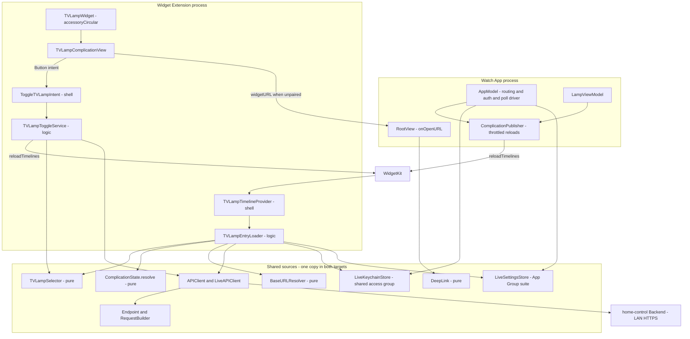
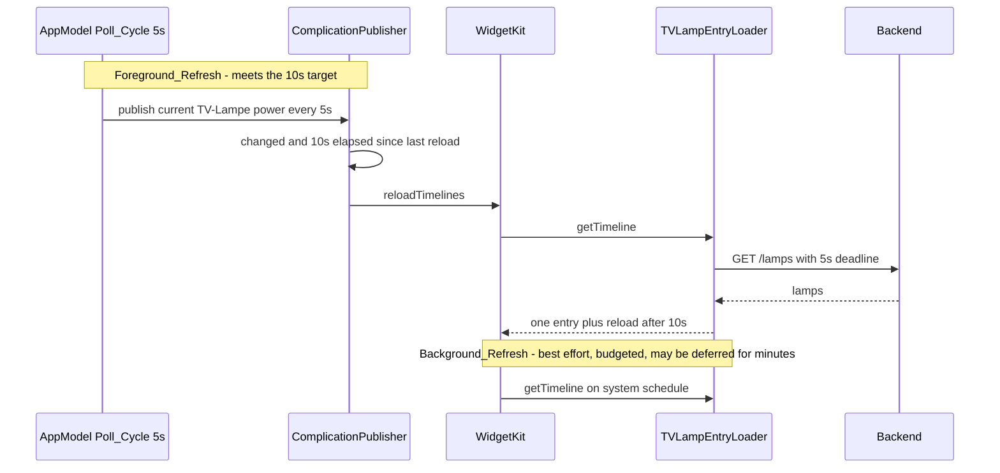
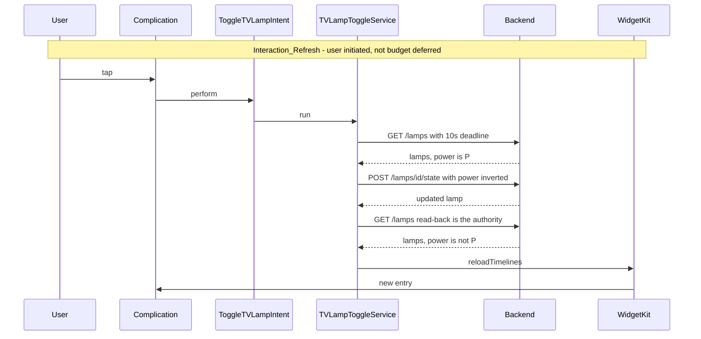

# Design Document

## Overview

This document describes the design of the **TV-Lampe complication**: a watchOS
watch-face complication for the existing standalone **WatchHomeControl** app. The
complication renders the label "TV" in the round `accessoryCircular` slot, coloured
green (on), red (off), or grey (unknown), and toggles the TV-Lampe when tapped.

The feature adds one new Xcode target — a **widget extension** — and a small amount
of new logic to the existing app target. It reuses the app's existing core layer
unchanged: `Endpoint`, `RequestBuilder`, `APIClient`/`LiveAPIClient`, `LampDTO`,
`URLValidator`, and `Strings`. Two existing components change behaviour: the
Keychain store moves to a shared access group, and the settings store moves to an
App Group `UserDefaults` suite, because the extension runs in its own process.

Everything is built with Apple-native tooling: **WidgetKit** (widget, timeline
provider), **AppIntents** (the toggle), **SwiftUI** (the complication view),
**Swift Concurrency**, **URLSession**, **Keychain Services**, and **UserDefaults**.
No third-party runtime dependencies.

### Design Goals

- **Honest refresh model.** watchOS runs no timer for widgets. The design names three
  distinct refresh paths and states plainly which of them can meet the 10-second
  target interval.
- **Thin platform shells, fat testable core.** WidgetKit and AppIntents types cannot
  be instantiated in unit tests (`TimelineProviderContext` has no public initializer),
  so all decision logic lives in plain Swift types that the test target drives
  directly. The `TimelineProvider`, the `AppIntent`, and the SwiftUI view are
  parameter-free shells.
- **One copy of every source file.** Shared logic lives in the app target's folders
  and is added to the extension target by target membership, never by copying.
- **Correct taps over fresh pixels.** Displayed state may be stale; a tap must not be.
  The intent re-reads the lamp before commanding it, so correctness never depends on
  the entry's age.
- **Secure credential handling.** The API_Key stays in the Keychain only; the
  extension reads it and never writes it.

### Research Notes

Platform facts that shape this design (Apple developer documentation, rephrased):

- **A reload policy is a request, not a schedule.** WidgetKit decides when to ask for a
  new timeline. On watchOS, background reloads are drawn from a limited daily budget
  that the system allocates per complication, so a `.after(now + 10s)` policy is
  honoured only occasionally in practice. Reloads triggered while the owning app is
  running, and reloads that follow a user interaction with the widget, are the
  reliable paths.
- **Interactive widgets** are available from watchOS 10: a widget's body may contain a
  `Button(intent:)` or `Toggle(intent:)` whose `AppIntent` runs in the background
  without foregrounding the app. `accessoryCircular` supports this; `accessoryInline`
  does not — which is one reason the spec narrows to a single family.
- **Widget rendering modes.** The watch face, not the widget, picks the rendering mode
  (`fullColor`, `accented`, `vibrant`). Custom colours survive only in `fullColor`;
  other modes flatten content into the face's tint. The view therefore reads
  `@Environment(\.widgetRenderingMode)` and applies the state colour only when the mode
  is `fullColor`.
- **Widgets must declare a container background** (`containerBackground(for: .widget)`)
  or they fail to render correctly on watchOS.
- **Keychain access groups are not auto-prefixed when set explicitly.** Supplying
  `kSecAttrAccessGroup` requires the fully qualified `<TeamID>.<group>` value; an
  unprefixed value fails with `errSecMissingEntitlement` (-34018). Only the default
  group (when the attribute is omitted) gets the prefix implicitly.
- **Keychain accessibility.** The default protection class is
  `kSecAttrAccessibleWhenUnlocked`. A complication refresh can run while the watch is
  locked, so the credential must be stored with `kSecAttrAccessibleAfterFirstUnlock`.
- **App Groups on watchOS** provide the shared `UserDefaults` suite used for the
  non-secret Base_URL; both the app and its embedded extension must carry the
  entitlement.

See [Apple Developer Documentation](https://developer.apple.com/documentation/) for the
authoritative reference.

## Architecture

Two processes share one credential store, one settings suite, and one core layer.



### Target layout

| Target | Product | Bundle id | Contents |
| --- | --- | --- | --- |
| `WatchHomeControl Watch App` | watchOS app | `ch.reber.watchhomecontrol.watchkitapp` | existing app + new shared logic |
| `WatchHomeControlComplication` | widget extension (embedded in the app) | `ch.reber.watchhomecontrol.watchkitapp.complication` | WidgetKit/AppIntents shells + membership of shared sources |
| `WatchHomeControlTests` | unit tests | unchanged | tests the app target via `@testable import` |

Shared logic is **not** extracted into a framework. A personal, single-developer app
does not justify the module boundary, and the test target already links the app
target. Files live under `WatchHomeControl Watch App/` and gain membership in the
extension target — one file, two compile units, no forks.

### Refresh model

Three paths produce a new timeline entry. Only the first meets the 10-second target.





The read-back is a second `GET /lamps` rather than the `POST` response body: the
command response reports what the Backend accepted, while the subsequent read
reports what the lamp actually is after the bridge applied it. Requirement 5.4
mandates the read-back; the `POST` response is used only for error detection.

## Components and Interfaces

### 1. Changed: `LiveKeychainStore` (shared access group)

```swift
final class LiveKeychainStore: KeychainStore, @unchecked Sendable {
    static let service = "ch.reber.watchhomecontrol"
    static let account = "api_key"
    /// MUST be fully qualified: an explicitly supplied access group is NOT
    /// auto-prefixed with the team id (-34018 otherwise).
    static let accessGroup = "5V4FMXSU55.ch.reber.watchhomecontrol.shared"

    init(service: String = Self.service,
         account: String = Self.account,
         accessGroup: String? = Self.accessGroup)
}
```

- `baseQuery` gains `kSecAttrAccessGroup` when `accessGroup != nil`.
- `saveAPIKey` adds `kSecAttrAccessible: kSecAttrAccessibleAfterFirstUnlock` on the
  `SecItemAdd` path, and includes it in the `SecItemUpdate` attribute dictionary so an
  existing item is upgraded in place.
- `readAPIKey` keeps returning `nil` on any non-success `OSStatus`, which is exactly
  the "treat a failed Keychain read as Unpaired" behaviour Requirement 6.6 asks for.
- The `accessGroup: nil` initializer is what the legacy purge uses to reach the old,
  default-group item.

### 2. Changed: `LiveSettingsStore` (App Group suite)

```swift
final class LiveSettingsStore: SettingsStore, @unchecked Sendable {
    static let appGroupID = "group.ch.reber.watchhomecontrol"
    static let defaultBaseURL = URL(string: "https://192.168.1.122:8443")!
    static let baseURLKey = "base_url"
    static var sharedDefaults: UserDefaults { UserDefaults(suiteName: appGroupID) ?? .standard }

    init(defaults: UserDefaults = LiveSettingsStore.sharedDefaults)
}
```

`baseURL` is expressed through the new pure resolver so app and extension agree:

```swift
enum BaseURLResolution: Equatable {
    case configured(URL)      // stored and valid
    case fallbackDefault(URL) // nothing stored -> default
    case invalid              // stored but not a valid absolute http(s) URL with host
}

enum BaseURLResolver {
    static func resolve(_ raw: String?) -> BaseURLResolution
}
```

- `nil` or whitespace-only → `.fallbackDefault(defaultBaseURL)`.
- `URLValidator.validate(raw)` succeeds → `.configured(url)`.
- otherwise → `.invalid`.

`LiveSettingsStore.baseURL` maps `.invalid` to the default so the app's behaviour is
unchanged; the complication inspects the resolution directly and renders Unknown for
`.invalid` without issuing a request (Requirements 3.9, 8.2).

### 3. New: `LegacyStatePurge` (no migration)

```swift
enum LegacyStatePurge {
    static let didRunKey = "legacy_state_purged_shared_v1"

    @discardableResult
    static func runIfNeeded(
        sharedDefaults: UserDefaults = LiveSettingsStore.sharedDefaults,
        standardDefaults: UserDefaults = .standard,
        legacyKeychain: KeychainStore = LiveKeychainStore(accessGroup: nil)
    ) -> Bool
}
```

Called from `WatchHomeControlApp.init()` before `AppModel` is constructed. When
`didRunKey` is unset it deletes the legacy default-group Keychain item, removes
`base_url` from `UserDefaults.standard`, sets the flag in the shared suite, and
returns `true`. Idempotent, at most once per install; a credential paired afterwards
is never touched because the flag is already set (Requirements 7.9, 7.10).

### 4. New pure core (app target, shared with the extension)

```swift
enum TVLampResolution: Equatable {
    case resolved(LampDTO)
    case unresolved
}

enum TVLampSelector {
    static let nameNeedle = "TV-Lampe"
    /// First lamp whose `displayName` contains "TV-Lampe" case-insensitively.
    static func select(from lamps: [LampDTO]) -> TVLampResolution
}

enum PairingCondition: Equatable { case paired, unpaired }

enum ComplicationState: String, Equatable, Codable {
    case on, off, unknown

    /// Total function: every (pairing, resolution) pair yields exactly one state.
    static func resolve(pairing: PairingCondition, resolution: TVLampResolution) -> ComplicationState
}
```

Mapping table (Requirements 2.1–2.4, 10.2, 10.3):

| pairing | resolution | state |
| --- | --- | --- |
| `.paired` | `.resolved(power == true)` | `.on` |
| `.paired` | `.resolved(power == false)` | `.off` |
| `.paired` | `.unresolved` | `.unknown` |
| `.unpaired` | any | `.unknown` |

Timing and identity constants:

```swift
enum ComplicationTiming {
    static let providerTimeout = Duration.seconds(5)
    static let commandTimeout = Duration.seconds(10)
    static let refreshInterval = Duration.seconds(10)
}

enum ComplicationKind { static let tvLamp = "TVLampComplication" }
```

### 5. New: entry and entry loader

```swift
struct TVLampEntry: TimelineEntry, Equatable {
    let date: Date
    let state: ComplicationState
    let interaction: Interaction

    enum Interaction: Equatable {
        case toggle      // paired: tap runs ToggleTVLampIntent
        case openSetup   // unpaired: tap opens the app via widgetURL
    }
}
```

```swift
struct ComplicationEnvironment: Sendable {
    var readAPIKey: @Sendable () -> String?
    var resolveBaseURL: @Sendable () -> BaseURLResolution
    var api: APIClient
    var refresher: ComplicationRefreshing
    var now: @Sendable () -> Date
    static let live: ComplicationEnvironment
}

struct TVLampEntryLoader: Sendable {
    let env: ComplicationEnvironment
    func load() async -> TVLampEntry
    func placeholder() -> TVLampEntry   // no I/O, `.on`, `.toggle`
}
```

`load()` — one path per Requirement 3 criterion:

1. `readAPIKey() == nil` → `TVLampEntry(.unknown, .openSetup)`, no request (3.7, 6.1).
2. `resolveBaseURL() == .invalid` → `(.unknown, .toggle)`, no request (3.9, 8.2).
3. otherwise `try await api.fetchLamps(timeout: providerTimeout)`:
   - success → `ComplicationState.resolve(pairing: .paired, resolution: TVLampSelector.select(from:))` (3.3, 3.8).
   - `APIError.timeout` → `.unknown` (3.4).
   - `APIError.unauthorized` → `.unknown`, credential untouched (3.6).
   - any other error → `.unknown` (3.5).

The loader never throws and never writes to the Keychain (3.15, 7.8).

### 6. New: WidgetKit shells

```swift
struct TVLampTimelineProvider: TimelineProvider {
    private let loader = TVLampEntryLoader(env: .live)

    func placeholder(in context: Context) -> TVLampEntry
    func getSnapshot(in context: Context, completion: @escaping (TVLampEntry) -> Void)
    func getTimeline(in context: Context, completion: @escaping (Timeline<TVLampEntry>) -> Void)
}
```

`getTimeline` returns exactly one entry dated now with
`.after(now + ComplicationTiming.refreshInterval)` and no pre-computed future entries
(Requirement 3.10). `placeholder`/`getSnapshot` return `loader.placeholder()` with no
network access (3.2).

```swift
struct TVLampWidget: Widget {
    var body: some WidgetConfiguration {
        StaticConfiguration(kind: ComplicationKind.tvLamp, provider: TVLampTimelineProvider()) { entry in
            TVLampComplicationView(entry: entry)
        }
        .configurationDisplayName(Strings.complicationDisplayName) // "TV-Lampe"
        .description(Strings.complicationDescription)
        .supportedFamilies([.accessoryCircular])
    }
}

@main
struct WatchHomeControlComplicationBundle: WidgetBundle {
    var body: some Widget { TVLampWidget() }
}
```

### 7. New: complication view

```swift
struct TVLampComplicationView: View {
    @Environment(\.widgetRenderingMode) private var renderingMode
    let entry: TVLampEntry

    var body: some View {
        content
            .containerBackground(.clear, for: .widget)
    }
}
```

- Label is always `Strings.complicationLabel` (`"TV"`), never empty (Requirements 1.3,
  2.6, 9.3).
- Colour comes from a pure `ComplicationState.labelColor` (`.green` / `.red` / `.gray`),
  applied only when `renderingMode == .fullColor`; other modes render the plain label so
  the complication still draws (1.4, 1.5, 2.5).
- `entry.interaction == .toggle` wraps the label in
  `Button(intent: ToggleTVLampIntent()) { … }.buttonStyle(.plain)` (5.1).
- `entry.interaction == .openSetup` leaves the label unwrapped and applies
  `.widgetURL(DeepLink.setupURL)` so a tap opens the app instead of toggling (5.11, 6.2).

### 8. New: toggle intent and service

```swift
struct ToggleTVLampIntent: AppIntent {
    static var title: LocalizedStringResource = "TV-Lampe schalten"
    static var isDiscoverable: Bool = false      // complication-only, not a Shortcuts action
    static var openAppWhenRun: Bool = false      // runs in the background (5.10)

    func perform() async throws -> some IntentResult {
        _ = await TVLampToggleService(env: .live).run()
        return .result()
    }
}

struct TVLampToggleService: Sendable {
    let env: ComplicationEnvironment

    enum Outcome: Equatable {
        case toggled(ComplicationState)  // command + read-back succeeded
        case readBackFailed              // command succeeded, read-back did not
        case unresolved                  // no TV-Lampe in the response
        case unpaired
        case failed(APIError)
    }

    func run() async -> Outcome
}
```

Algorithm (Requirement 5):

1. `readAPIKey() == nil` → request a reload, return `.unpaired` (defensive; the view
   does not offer the button while unpaired).
2. `GET /lamps` with `commandTimeout`. Failure → reload, `.failed`.
3. `TVLampSelector.select(from:)`. `.unresolved` → reload, **no POST**, `.unresolved` (5.6).
4. `POST /lamps/{id}/state` with `power: !lamp.state.power` (5.3). Failure → reload, `.failed`.
5. `GET /lamps` read-back (5.4). Failure → reload, `.readBackFailed` (5.5).
6. Map the read-back to a `ComplicationState`, reload, return `.toggled(state)`.

Every path ends in exactly one `refresher.reload()` (5.4–5.9). The service never reads
the displayed entry, so a stale complication cannot invert the command (5.2).

### 9. New: reload seam and throttled publisher

```swift
protocol ComplicationRefreshing: Sendable {
    func reload()
}

struct LiveComplicationRefresher: ComplicationRefreshing {
    func reload() { WidgetCenter.shared.reloadTimelines(ofKind: ComplicationKind.tvLamp) }
}

final class SpyComplicationRefresher: ComplicationRefreshing, @unchecked Sendable {
    private(set) var reloadCount: Int
}
```

```swift
@MainActor
final class ComplicationPublisher {
    init(refresher: ComplicationRefreshing,
         minimumInterval: Duration = ComplicationTiming.refreshInterval,
         now: @escaping () -> Date = Date.init)

    /// Called from the 5s Poll_Cycle and after lamp commands with the current
    /// TV-Lampe power (`nil` when the lamp is not in the list).
    func publish(tvLampPower: Bool?)

    /// Pairing succeeded, credential deleted, 401 handled, Base_URL changed.
    func publishImmediately()
}
```

Throttle rule (Requirements 7.12, 7.13): `publish` reloads only when the power differs
from the last *published* value. If a change arrives sooner than `minimumInterval`
after the previous reload, it is held as pending and emitted on the first `publish`
call after the interval elapses — with the app's 5-second poll cycle that is at most
one cycle late. `publishImmediately` bypasses both the change check and the throttle,
because pairing state changes must reach the face at once.

### 10. New: deep link

```swift
enum DeepLink {
    static let scheme = "watchhomecontrol"
    static let setupHost = "setup"
    static let setupURL = URL(string: "watchhomecontrol://setup")!
    static func isSetup(_ url: URL) -> Bool   // pure, case-insensitive scheme/host match
}
```

`RootView` gains `.onOpenURL { if DeepLink.isSetup($0) { model.openSetupFromComplication() } }`.
`AppModel.openSetupFromComplication()` stops polling, refreshes `baseURLField`, and sets
`route = .setup`, unconditionally — so a paired-but-rejected credential also lands on the
Einrichtung screen where a new pairing code can be entered (Requirements 6.2–6.4).

### 11. App wiring changes

| Site | Change |
| --- | --- |
| `WatchHomeControlApp.init` | run `LegacyStatePurge.runIfNeeded()`; build `LiveSettingsStore()` on the App Group suite; build the `ComplicationPublisher` and hand it to `AppModel` |
| `AppModel.submitSetup` (success) | `publisher.publishImmediately()` after the key is stored (7.11) |
| `AppModel.handleAuthError` | `publisher.publishImmediately()` (6.4) |
| `AppModel` Base_URL persistence | `publisher.publishImmediately()` after `settings.setBaseURL` (7.11) |
| `AppModel` Poll_Cycle | after `lamps.applyPoll(fetched)`, call `publisher.publish(tvLampPower: TVLampSelector.select(from: fetched).power)` (7.12) |
| `LampViewModel.toggle` (success) | forward the updated TV-Lampe power to the publisher (7.12) |
| `RootView` | `.onOpenURL` deep-link handling (6.3) |
| `Strings` | add `complicationLabel = "TV"`, `complicationDisplayName = "TV-Lampe"`, `complicationDescription` (9.2) |

## Data Models

No Backend contract changes. The complication reuses `LampDTO`, `LampState`,
`LampsResponse`, `LampCommandResponse`, `Endpoint.lamps`, `Endpoint.lampState`, and
`APIError` as they exist today. New types are the ones listed above:
`TVLampResolution`, `PairingCondition`, `ComplicationState`, `BaseURLResolution`,
`TVLampEntry`, `ComplicationEnvironment`, `TVLampToggleService.Outcome`.

## Error Handling

| Condition | Provider result | Intent result | Credential |
| --- | --- | --- | --- |
| No API_Key / Keychain read fails | `.unknown`, `.openSetup`, no request | not reachable from the view | untouched |
| Base_URL `.invalid` | `.unknown`, no request | `.failed` (no request) | untouched |
| Timeout (5s provider / 10s intent) | `.unknown` | abort, reload | untouched |
| Network / transport error | `.unknown` | abort, reload | untouched |
| HTTP 401 | `.unknown` | abort, reload | **untouched** — the app handles re-pairing |
| Non-2xx | `.unknown` | abort, reload | untouched |
| No lamp matching "TV-Lampe" | `.unknown` | no POST sent, reload | untouched |

The extension never deletes or rewrites the API_Key: only the app owns credential
lifecycle, and its existing 401 path already routes to the Einrichtung screen.

## Correctness Properties

Each property maps to exactly one property-based test, tagged
`Feature: tv-lamp-complication, Property {n}: {text}`, minimum 100 iterations.

### Property 1: TV-Lampe selection returns the first case-insensitive "TV-Lampe" match or nothing

For any generated lamp list (empty, no match, one match, several matches, mixed
`friendly_name` present/empty/absent), `TVLampSelector.select` returns `.resolved` with
the first lamp whose `displayName` contains "TV-Lampe" ignoring case, and `.unresolved`
when none does. Pure: identical input yields identical output, no I/O.
**Validates: Requirements 4.1–4.5, 10.1**

### Property 2: Complication state mapping is total and pure

For every `(PairingCondition, TVLampResolution)` pair, `ComplicationState.resolve`
returns exactly one of `.on`, `.off`, `.unknown`, follows the mapping table, and is
`.unknown` for every unpaired input.
**Validates: Requirements 2.1–2.4, 10.2, 10.3**

### Property 3: Base_URL resolution classifies absent, valid, and invalid values

For generated raw strings, `BaseURLResolver.resolve` returns `.fallbackDefault` exactly
for `nil`/blank, `.configured` exactly for strings `URLValidator` accepts, and `.invalid`
otherwise; `.configured` round-trips the parsed URL.
**Validates: Requirements 3.9, 7.7, 8.2**

### Property 4: Complication requests are built by the shared builder with the key and body

For generated lamp ids and power values, the `GET /lamps` and `POST /lamps/{id}/state`
requests produced through `RequestBuilder` carry the right method, path, `X-API-Key`,
`Content-Type: application/json`, and `{"power": …}` body.
**Validates: Requirements 8.5, 8.6, 8.9, 10.4**

### Property 5: Keychain queries always carry the qualified access group and accessibility

Every query `LiveKeychainStore` builds contains `kSecAttrAccessGroup` equal to
`5V4FMXSU55.ch.reber.watchhomecontrol.shared` (team-prefixed), and every write carries
`kSecAttrAccessibleAfterFirstUnlock`.
**Validates: Requirements 7.1–7.3**

### Property 6: The toggle service reads, inverts, and reads back, never trusting the entry

For any generated starting power and lamp list, `TVLampToggleService.run` against a stub
`APIClient` issues exactly `GET /lamps` → `POST /lamps/{id}/state` with the inverted
power → `GET /lamps`, in that order, and issues no `POST` when the lamp is unresolved.
The command is independent of any state supplied by the displayed entry.
**Validates: Requirements 5.2–5.6, 10.7**

### Property 7: Foreground refresh is emitted only on change and at most once per interval

For generated sequences of (timestamp, power) samples, `ComplicationPublisher` triggers
no reload when the power is unchanged, and never more than one reload per 10-second
window; each observed change eventually produces exactly one reload.
**Validates: Requirements 3.14, 7.12, 7.13**

### Property 8: Only the setup deep link is accepted

For generated URLs, `DeepLink.isSetup` is true exactly for `watchhomecontrol://setup`
(scheme and host compared case-insensitively) and false for every other scheme, host, or
path.
**Validates: Requirements 6.2, 6.3, 11.6**

## Testing Strategy

The existing conventions apply unchanged: **Swift Testing** (`import Testing`,
`@testable import WatchHomeControl_Watch_App`), a seeded LCG for reproducible
generation, ≥100 iterations per property, one file per property test.

### Testability boundaries

- `TimelineProviderContext` cannot be constructed, so `TVLampTimelineProvider` is not
  unit-tested; `TVLampEntryLoader` is, through `ComplicationEnvironment` with a stub
  `APIClient`, an `InMemoryKeychainStore`, and a `SpyComplicationRefresher`.
- `AppIntent.perform()` is a one-line shell; `TVLampToggleService` carries the logic and
  is fully tested.
- SwiftUI rendering is covered by a smoke test asserting the view builds for each
  `ComplicationState`, plus a pure test of `ComplicationState.labelColor`.

### Example / unit tests

- **Entry loader branches**: unpaired → `(.unknown, .openSetup)` with zero API calls;
  invalid Base_URL → `.unknown` with zero API calls; success on/off; timeout; 401;
  non-2xx; network error; empty list; no match.
- **Reload policy**: the timeline carries exactly one entry and `.after(date + 10s)`.
- **Toggle service outcomes**: `.toggled`, `.readBackFailed`, `.unresolved`, `.unpaired`,
  `.failed` — each asserting the ordered endpoint sequence and exactly one reload.
- **Legacy purge**: deletes the legacy item and `base_url`, sets the flag, is a no-op on
  the second call, and leaves a newly paired credential intact.
- **Routing**: `openSetupFromComplication()` routes to `.setup` from `.control` and from
  `.setup`, and stops polling.
- **Strings**: complication strings are non-empty and German.

### Device / integration checks (manual, not automated)

Keychain sharing and App Group access cannot be verified in the simulator —
`LiveKeychainIntegrationTests` already skips on -34018, which would mask a missing or
unprefixed access group. After wiring the entitlements, verify on the watch:

1. pair in the app, confirm the complication turns green/red within one poll cycle;
2. tap the complication with the app closed and confirm the lamp switches;
3. lock the watch, wait for a background refresh, confirm the state is not grey
   (proves `kSecAttrAccessibleAfterFirstUnlock`);
4. delete the credential and confirm a tap opens the Einrichtung screen.

## Xcode Project Configuration

### New target

- Template: **Widget Extension** (watchOS), embedded in `WatchHomeControl Watch App`.
- `PRODUCT_BUNDLE_IDENTIFIER = ch.reber.watchhomecontrol.watchkitapp.complication`
- `WATCHOS_DEPLOYMENT_TARGET = 11.0`, `SWIFT_VERSION = 6.0`, `DEVELOPMENT_TEAM = 5V4FMXSU55`
- `CODE_SIGN_ENTITLEMENTS` set on **both** targets.

### Entitlements (identical in both files)

```xml
<key>keychain-access-groups</key>
<array>
    <string>$(AppIdentifierPrefix)ch.reber.watchhomecontrol.shared</string>
</array>
<key>com.apple.security.application-groups</key>
<array>
    <string>group.ch.reber.watchhomecontrol</string>
</array>
```

The entitlement uses `$(AppIdentifierPrefix)`; the runtime `kSecAttrAccessGroup` value
must be the expanded, fully qualified string. Both App IDs need Keychain Sharing and App
Groups enabled so `release.sh` can sign.

### Extension `Info.plist`

```xml
<key>NSAppTransportSecurity</key>
<dict><key>NSAllowsLocalNetworking</key><true/></dict>
<key>NSExtension</key>
<dict><key>NSExtensionPointIdentifier</key><string>com.apple.widgetkit-extension</string></dict>
```

TLS to the self-signed Backend relies on the device-installed trust profile; no
server-trust override is implemented (Requirement 8.4).

### App `Info.plist`

Add the `watchhomecontrol` URL scheme via `CFBundleURLTypes` so the Setup_Deep_Link
resolves (Requirement 11.6).

### Target membership of shared sources

Added to the extension target: `Models/DTOs.swift`, `Models/Errors.swift`,
`Networking/Endpoint.swift`, `Networking/RequestBuilder.swift`, `Networking/APIClient.swift`,
`Networking/LiveAPIClient.swift`, `Persistence/KeychainStore.swift`,
`Persistence/SettingsStore.swift`, `Persistence/BaseURLResolver.swift`,
`Utilities/URLValidator.swift`, `Utilities/DeepLink.swift`, `Strings.swift`, and the whole
new `Complication/` group. Not added: `State/`, `Views/`, `WatchHomeControlApp.swift`.

## Project Structure

```
WatchHomeControl Watch App/
  Complication/                     ← new, shared with the extension target
    ComplicationState.swift         (state enum, resolve, labelColor)
    TVLampSelector.swift            (pure selection)
    TVLampEntry.swift               (TimelineEntry + Interaction)
    TVLampEntryLoader.swift         (provider logic, no WidgetKit context)
    TVLampToggleService.swift       (read → toggle → read)
    ComplicationEnvironment.swift   (composition root for both shells)
    ComplicationRefreshing.swift    (seam + live + spy)
    ComplicationPublisher.swift     (throttled app-side reloads)
    ComplicationTiming.swift        (5s / 10s / 10s, kind)
  Persistence/
    BaseURLResolver.swift           ← new
    LegacyStatePurge.swift          ← new
    KeychainStore.swift             ← changed (access group, accessibility)
    SettingsStore.swift             ← changed (App Group suite, resolver)
  Utilities/
    DeepLink.swift                  ← new
  Strings.swift                     ← changed (3 new strings)
  Views/RootView.swift              ← changed (onOpenURL)
  State/AppModel.swift              ← changed (publisher hooks, deep-link route)
  State/LampViewModel.swift         ← changed (publish after command)
  WatchHomeControlApp.swift         ← changed (purge, shared stores, publisher)

WatchHomeControlComplication/       ← new target
  WatchHomeControlComplicationBundle.swift
  TVLampWidget.swift
  TVLampTimelineProvider.swift
  TVLampComplicationView.swift
  ToggleTVLampIntent.swift
  Info.plist
  WatchHomeControlComplication.entitlements

WatchHomeControlTests/              ← new test files
  TVLampSelectionPropertyTests.swift
  ComplicationStateMappingPropertyTests.swift
  BaseURLResolutionPropertyTests.swift
  ComplicationRequestShapePropertyTests.swift
  KeychainAccessGroupPropertyTests.swift
  ToggleSequencePropertyTests.swift
  ForegroundRefreshThrottlePropertyTests.swift
  DeepLinkPropertyTests.swift
  TVLampEntryLoaderExampleTests.swift
  TVLampToggleServiceExampleTests.swift
  LegacyStatePurgeExampleTests.swift
  ComplicationRoutingExampleTests.swift
```

## Requirements Traceability

| Requirement | Design element |
| --- | --- |
| 1.1–1.2, 1.7 | `TVLampWidget` (`StaticConfiguration`, `supportedFamilies([.accessoryCircular])`, display name/description) |
| 1.3–1.5, 2.1–2.6 | `TVLampComplicationView`, `ComplicationState.labelColor`, `widgetRenderingMode` handling |
| 1.6, 3.3–3.9 | `TVLampEntryLoader.load()` branches |
| 3.1, 8.1, 8.5–8.9 | `LiveAPIClient` + `RequestBuilder` reuse, `ComplicationTiming` |
| 3.2 | `TVLampEntryLoader.placeholder()` |
| 3.10–3.12, 3.15 | `TVLampTimelineProvider.getTimeline` single entry + `.after(+10s)`, never-throwing loader |
| 3.13, 5.4–5.9 | `TVLampToggleService` reload on every path |
| 3.14, 7.11–7.14 | `ComplicationPublisher`, `AppModel`/`LampViewModel` hooks |
| 4.1–4.6, 10.1 | `TVLampSelector` |
| 5.1, 5.11 | `TVLampEntry.Interaction`, `Button(intent:)` vs `.widgetURL` |
| 5.2–5.3, 5.10 | `TVLampToggleService.run()`, `openAppWhenRun = false` |
| 6.1, 6.6 | Unpaired branch in the loader; `readAPIKey` returning `nil` on any failure |
| 6.2–6.4 | `DeepLink`, `RootView.onOpenURL`, `AppModel.openSetupFromComplication`, `handleAuthError` |
| 6.5 | `ComplicationPublisher.publishImmediately()` on credential deletion |
| 7.1–7.3 | `LiveKeychainStore` access group + `kSecAttrAccessibleAfterFirstUnlock` |
| 7.4–7.7 | `LiveSettingsStore` on the App Group suite, `BaseURLResolver` |
| 7.8 | Extension reads only; no Keychain writes, no logging |
| 7.9–7.10 | `LegacyStatePurge` |
| 8.2 | `BaseURLResolution.invalid` branch |
| 8.3–8.4 | Extension `Info.plist` ATS, device trust profile |
| 9.1–9.3 | `Strings.complicationLabel` / `complicationDisplayName` / `complicationDescription` |
| 10.1–10.5 | Properties 1–4, pure types |
| 10.6–10.7 | `ComplicationEnvironment` seams, `TVLampToggleService` sequence tests |
| 11.1–11.5 | New target, entitlements, App ID capabilities, target membership |
| 11.6 | `CFBundleURLTypes` + `DeepLink` |
