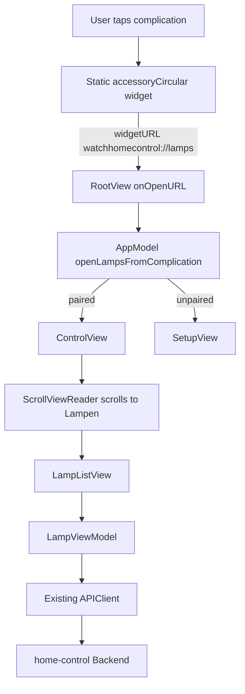

# Design: TV-Lampe App Shortcut

## Overview

The complication is a static launcher, not a second lamp UI. It displays a neutral
lamp glyph and "TV" in an `accessoryCircular` slot. A tap opens the full
WatchHomeControl app using `watchhomecontrol://lamps`; the app routes to the existing
Control screen and scrolls the Lampen section into view. The user sees the current
Backend state and operates the existing in-app Toggle there.

The widget never reads Keychain or UserDefaults, never calls the Backend, never
runs an App Intent, and never schedules a timeline refresh. The Watch_App retains
ownership of pairing, network requests, and lamp controls.

## Architecture

### Widget rendering

- `StaticConfiguration` supports only `.accessoryCircular`.
- `TVLampComplicationView` shows a fixed lamp glyph and the shared `Strings.complicationLabel` (`TV`) in a neutral style.
- `.widgetURL(DeepLink.lampsURL)` opens the app. There is no Button/Toggle intent.
- The timeline provider returns a static entry with `.never`; placeholder, snapshot, and timeline requests do no I/O.
- The German gallery name and description distinguish this launcher from other widgets.

### Deep-link routing

`DeepLink` recognizes the `watchhomecontrol` scheme and routes `setup` and `lamps`
hosts case-insensitively. `RootView.onOpenURL` dispatches the lamps URL to
`AppModel.openLampsFromComplication()`:

1. If no API key is stored, remain on the normal Setup route.
2. If paired, set the app route to Control and increment `lampFocusRequestID`.
3. `ControlView` uses `ScrollViewReader`; on appearance or a changed request ID it
   scrolls to the identified Lampen section.
4. The existing `LampViewModel`, poll driver, APIClient, and row Toggle remain the
   only implementation of lamp listing and control.

Repeated taps increment the focus request even if Control is already visible, so
the list scrolls back to the Lampen section each time.

### Persistence and networking

The widget no longer consumes the shared API key or Base_URL and cannot issue
Backend requests. The Watch_App's existing shared Keychain/App Group setup is
preserved for app pairing and networking; the extension entitlements remain
configured but are not read by widget code. No APNs or background-refresh mechanism
is needed for a launcher-only widget.

### Xcode target membership

The extension needs only its own SwiftUI/WidgetKit shell plus the shared `Strings`,
`DeepLink`, `ComplicationKind`, and `TVLampEntry` definitions. It must exclude the
app's `State`, `Views`, `Models`, `Networking`, `Persistence`, URL validator, assets,
app entry point, and app Info.plist. A `PBXFileSystemSynchronizedBuildFileExceptionSet`
keeps those app-only sources out of the extension.

## Testing Strategy

- Property-test `DeepLink.isSetup` and `DeepLink.isLamps` for case-insensitive
  matching and rejection of unrelated schemes/hosts.
- Example-test `AppModel.openLampsFromComplication`: paired routes to Control and
  increments the focus request each time; unpaired routes to Setup.
- Existing lamp-control tests remain unchanged and ensure the in-app toggle still
  uses its existing command and state rollback behavior.
- Build both the app and extension for watchOS Simulator; verify the static provider
  and shortcut widget compile with no network or AppIntent dependency.
- On device, add the TV-Lampe shortcut to a circular slot, tap it while paired, and
  verify the app opens with Lampen at the top. Remove the API key and verify the same
  link lands on Einrichtung.
